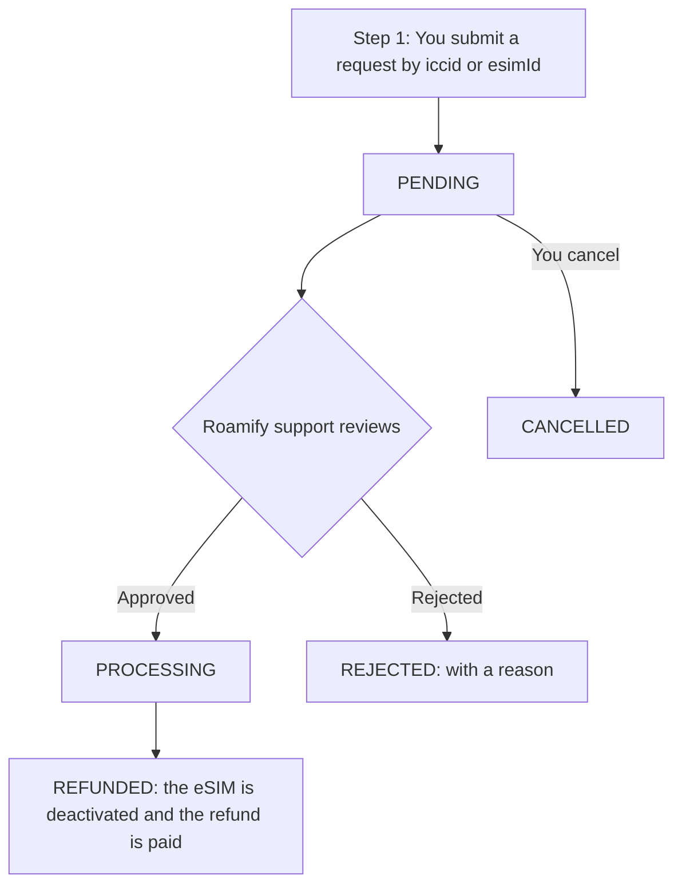

import { Callout, Tabs } from 'nextra/components';

# eSIM API - Refunds

## Table of Contents
- [How Refund Requests Work](#how-refund-requests-work)
- [Request a Refund in the Partner Portal](#request-a-refund-in-the-partner-portal)
- [Create a Refund Request](#create-a-refund-request)
- [Create Refund Requests in Bulk](#create-refund-requests-in-bulk)
- [Get a Refund Request](#get-a-refund-request)
- [List Refund Requests](#list-refund-requests)
- [Cancel a Refund Request](#cancel-a-refund-request)
- [The Refund Request Object](#the-refund-request-object)
- [Refund Reasons](#refund-reasons)
- [Refund Statuses](#refund-statuses)
- [Errors](#errors)

## How Refund Requests Work
A refund request asks Roamify support to refund one eSIM of one of your orders. **You submit a request, Roamify support reviews it, and the refund happens only after support approves it.** Submitting a request never moves money by itself, and it does not revoke the eSIM.



- Every request is decided by Roamify support. A request for an eSIM that was already installed or has used data is accepted and reviewed, not refused up front.
- The only request refused immediately is one for an eSIM that was **already refunded** (`422`).
- An eSIM can have **one open request at a time**. A second request while one is `PENDING` or `PROCESSING` is rejected with `409` and the `refundId` of the open request.
- The refund is paid back the way the order was paid. For an order paid with your balance, the amount is credited back to your balance.
- In the partner portal, only team members with the **ADMIN** or **OPERATION** role can submit and cancel requests. Other roles can only track them. API requests are made with your API key.

<Callout type="info" emoji="💡">
    Track a request with [Get a Refund Request](#get-a-refund-request), or configure a webhook URL to receive a [Refund event](/webhooks/types/refund) when a request is refunded or rejected.
</Callout>

## Request a Refund in the Partner Portal
You can also file and track requests in the Roamify partner portal. It uses the same rules as the API.

- **Inventory** (unassigned bundles): choose **Request refund** on a bundle. A side sheet opens with the eSIM ID already filled in. Pick a reason, add notes if you like, and submit.
- **eSIMs**: open **View eSIM** on an eSIM and choose **Request refund**. The sheet opens with the ICCID already filled in. Pick a reason and submit.
- **Refund Requests** page: lists every request with its status, lets you search by ICCID, cancel a pending request and open its details. **New refund request** lets you submit up to 50 ICCIDs at once, or one eSIM ID for an eSIM that has no ICCID yet.

The reason is required. When the reason is `OTHER`, the notes are required too (at least 10 characters).

## Create a Refund Request
To request a refund for one eSIM, send a `POST` request to the `/api/refund` endpoint.

You are required to provide the following parameters in the request body:
- `productType`: What is refunded. This is a required field of type `string`. Only `esim` is supported for now. Any other value is answered with `422` `REFUND_PRODUCT_TYPE_NOT_SUPPORTED`.
- `iccid` or `esimId`: Which eSIM. Provide **exactly one** of them, both of type `string`. Use `iccid` for an eSIM that was redeemed. Use `esimId` for an eSIM that has no ICCID yet, such as a bundle that was never assigned.
- `reason`: Why you are asking for the refund. This is a required field of type `string`. See [Refund Reasons](#refund-reasons).
- `notes`: Free text for the support team. This is an optional field of type `string` of up to 1000 characters. It is required, with at least 10 characters, when `reason` is `OTHER`.

### Usage - request a refund
<Tabs items={['curl', 'javascript']}>
    <Tabs.Tab index={0}>
        ```bash
        curl --request POST \
        --url 'https://api-dev.getroamify.com/api/refund' \
        --header 'Authorization: Bearer {{token}}' \
        --header 'Content-Type: application/json' \
        --data '{
            "productType": "esim",
            "iccid": "8935303411619613",
            "reason": "UNABLE_TO_INSTALL",
            "notes": "The customer could not scan the QR code on an iPhone 12."
        }'
        ```
    </Tabs.Tab>
    <Tabs.Tab index={1}>
        ```javascript
        const response = await fetch('https://api-dev.getroamify.com/api/refund', {
            method: 'POST',
            headers: {
                'Authorization': 'Bearer {access token here}',
                'Content-Type': 'application/json',
            },
            body: JSON.stringify({
                productType: 'esim',
                iccid: '8935303411619613',
                reason: 'UNABLE_TO_INSTALL',
                notes: 'The customer could not scan the QR code on an iPhone 12.',
            }),
        });
        const refund = await response.json();
        ```
    </Tabs.Tab>
</Tabs>

### Response
A new request answers `201` with the [refund request object](#the-refund-request-object) and a `tracking` object that tells you where to poll it.

```json
{
    "refundId": "9f3c1c0e-6a52-4b8e-9d0a-0d3f1e2a7c11",
    "status": "PENDING",
    "productType": "esim",
    "item": {
        "esimId": "74b73655-0fa7-49e4-bab6-eb80b5522104",
        "iccid": "8935303411619613",
        "orderId": "ee9357c2-0000-0000-0000-000000000000",
        "countryName": "Bahrain",
        "optionName": "5 GB - 3 Days"
    },
    "reason": "UNABLE_TO_INSTALL",
    "notes": "The customer could not scan the QR code on an iPhone 12.",
    "amount": null,
    "currency": null,
    "balanceCreditUsd": null,
    "transaction": null,
    "rejectionReason": null,
    "rejectionNote": null,
    "createdAt": 1762570000,
    "updatedAt": 1762570000,
    "processedAt": null,
    "cancelledAt": null,
    "history": [
        { "status": "PENDING", "at": 1762570000 }
    ],
    "tracking": {
        "method": "GET",
        "path": "/api/refund?refundId=9f3c1c0e-6a52-4b8e-9d0a-0d3f1e2a7c11"
    }
}
```

## Create Refund Requests in Bulk
To request refunds for several eSIMs in one call, send a `POST` request to the `/api/refund/bulk` endpoint.

- `productType`: As above. It applies to every entry.
- `refunds`: An array of between `1` and `20` entries. Each entry has the same `iccid` or `esimId` (exactly one), `reason` and `notes` fields as a single request.

<Callout type="warning" emoji="⚠️">
    A bad entry fails the **whole call** with `400`, and nothing is created. Fix the entry and send the call again. Entries that are valid but refused individually (for example an eSIM that already has an open request) are reported in the results instead.
</Callout>

```bash
curl --request POST \
--url 'https://api-dev.getroamify.com/api/refund/bulk' \
--header 'Authorization: Bearer {{token}}' \
--header 'Content-Type: application/json' \
--data '{
    "productType": "esim",
    "refunds": [
        { "iccid": "8935303411619613", "reason": "NO_CONNECTIVITY" },
        { "esimId": "74b73655-0fa7-49e4-bab6-eb80b5522104", "reason": "OTHER", "notes": "Customer cancelled the trip." }
    ]
}'
```

The call answers `200` with one result per entry, in the order you sent them:

```json
{
    "summary": { "requested": 2, "created": 1, "failed": 1, "duplicates": 0 },
    "results": [
        {
            "index": 0,
            "iccid": "8935303411619613",
            "status": "CREATED",
            "refund": { "refundId": "9f3c1c0e-6a52-4b8e-9d0a-0d3f1e2a7c11", "status": "PENDING" }
        },
        {
            "index": 1,
            "esimId": "74b73655-0fa7-49e4-bab6-eb80b5522104",
            "status": "FAILED",
            "error": {
                "code": "REFUND_REQUEST_ALREADY_EXISTS",
                "message": "A refund request is already open for this eSIM",
                "refundId": "2b1d7e40-0000-0000-0000-000000000000"
            }
        }
    ]
}
```

Each result has a `status` of:
- `CREATED`: the request was created. `refund` holds it.
- `FAILED`: the request was refused. `error` holds the `code` and `message`, plus `reasons` (for `REFUND_NOT_ELIGIBLE`) or the open `refundId` (for `REFUND_REQUEST_ALREADY_EXISTS`).
- `DUPLICATE`: the same `iccid` or `esimId` appeared earlier in the call. Only the first is created, and `duplicateOf` is the index of the entry that was kept.

## Get a Refund Request
To get one request, send a `GET` request to the `/api/refund` endpoint with **exactly one** of these query parameters:
- `refundId`: the request.
- `esimId`: the newest request for that eSIM.
- `iccid`: the newest request for that ICCID.

```bash
curl --request GET \
--url 'https://api-dev.getroamify.com/api/refund?refundId=9f3c1c0e-6a52-4b8e-9d0a-0d3f1e2a7c11' \
--header 'Authorization: Bearer {{token}}'
```

It answers `200` with the [refund request object](#the-refund-request-object), or `404` `REFUND_REQUEST_NOT_FOUND`.

## List Refund Requests
To list your requests, newest first, send a `GET` request to the `/api/refunds` endpoint. All query parameters are optional:
- `status`: Only requests with this [status](#refund-statuses).
- `iccid` or `esimId`: Only requests for that eSIM. Send at most one of them.
- `limit`: Page size, from `1` to `100`.
- `cursor`: The `nextCursor` of the previous page.

```bash
curl --request GET \
--url 'https://api-dev.getroamify.com/api/refunds?status=PENDING&limit=20' \
--header 'Authorization: Bearer {{token}}'
```

```json
{
    "items": [ { "refundId": "9f3c1c0e-6a52-4b8e-9d0a-0d3f1e2a7c11", "status": "PENDING" } ],
    "nextCursor": null
}
```

When `nextCursor` is not `null`, send it back as `cursor` to get the next page.

## Cancel a Refund Request
To withdraw a request, send a `PUT` request to `/api/refund/{refundId}/cancel`. Only a request that is still `PENDING` can be cancelled. Once support has acted on it, the call answers `409` `REFUND_INVALID_STATUS`.

```bash
curl --request PUT \
--url 'https://api-dev.getroamify.com/api/refund/9f3c1c0e-6a52-4b8e-9d0a-0d3f1e2a7c11/cancel' \
--header 'Authorization: Bearer {{token}}'
```

It answers `200` with the cancelled request, whose `status` is `CANCELLED`. You can submit a new request for the same eSIM afterwards.

## The Refund Request Object
| Field | Type | Description |
| --- | --- | --- |
| `refundId` | string | The ID of the request. |
| `status` | string | See [Refund Statuses](#refund-statuses). |
| `productType` | string | Always `esim` for now. |
| `item` | object | The eSIM: `esimId`, `orderId`, and when known `iccid` (only once the eSIM was redeemed), `referenceId`, `countryName` and `optionName`. |
| `reason` | string | See [Refund Reasons](#refund-reasons). |
| `notes` | string | Your notes. |
| `amount` | number \| null | The amount refunded, in `currency`. `null` until the request is `REFUNDED`. |
| `currency` | string \| null | The currency of `amount`. |
| `balanceCreditUsd` | number \| null | The amount credited to your balance in USD, for orders paid with your balance. |
| `transaction` | object \| null | The refund of the payment: `id`, `paymentMethod`, `paymentStatus` and `refundedAt`. |
| `rejectionReason` | string \| null | Why support rejected it: `DATA_USED`, `ESIM_ACTIVATED`, `OUTSIDE_REFUND_WINDOW`, `ESIM_EXPIRED`, `NETWORK_CONDITIONS_ONLY`, `INSUFFICIENT_INFORMATION`, `DUPLICATE_REQUEST` or `OTHER`. |
| `rejectionNote` | string \| null | Support's explanation, when given. |
| `createdAt`, `updatedAt`, `processedAt`, `cancelledAt` | number \| null | Unix timestamps in seconds. |
| `history` | array | Every status the request went through, as `{ status, at }`. |

## Refund Reasons
| Reason | Use it when |
| --- | --- |
| `UNABLE_TO_INSTALL` | The eSIM could not be installed or activated on the device. |
| `NO_CONNECTIVITY` | The eSIM is installed but there is no data connection at the destination. |
| `WRONG_PACKAGE` | The wrong destination or data plan was purchased. |
| `DUPLICATE_PURCHASE` | The eSIM was purchased more than once by mistake. |
| `TRIP_CANCELLED` | The trip was cancelled or changed. |
| `DEVICE_NOT_COMPATIBLE` | The customer's device does not support eSIM or is locked. |
| `CUSTOMER_REQUEST` | The customer changed their mind. |
| `OTHER` | Anything else. `notes` of at least 10 characters are required. |

## Refund Statuses
| Status | Meaning |
| --- | --- |
| `PENDING` | Submitted. Roamify support has not acted on it yet. You can cancel it. |
| `PROCESSING` | Approved. The refund is being processed. |
| `REFUNDED` | The refund is complete and the eSIM was deactivated. |
| `REJECTED` | Support rejected the request. See `rejectionReason` and `rejectionNote`. |
| `CANCELLED` | You cancelled the request before review. |

## Errors
Every error has the form `{ "message": "...", "status": "failed", "code": "..." }`.

| HTTP | `code` | Meaning |
| --- | --- | --- |
| `400` | `INVALID_PARAMETER` | A parameter is missing or invalid. For example both or neither of `iccid` and `esimId`, more than 20 bulk entries, or an invalid `limit`. |
| `400` | `REFUND_INVALID_REASON` | `reason` is not one of the [supported reasons](#refund-reasons). |
| `400` | `REFUND_NOTES_REQUIRED` | `reason` is `OTHER` without `notes` of at least 10 characters. |
| `404` | `ESIM_NOT_FOUND` | No eSIM of your account has that `iccid` or `esimId`. |
| `404` | `REFUND_REQUEST_NOT_FOUND` | No request matches the `refundId`, `esimId` or `iccid`. |
| `409` | `REFUND_REQUEST_ALREADY_EXISTS` | The eSIM already has an open request. The body carries its `refundId`. |
| `409` | `REFUND_INVALID_STATUS` | Only a `PENDING` request can be cancelled. |
| `422` | `REFUND_NOT_ELIGIBLE` | The eSIM cannot be refunded. `reasons` lists why, for example `ESIM_ALREADY_REFUNDED`. |
| `422` | `REFUND_PRODUCT_TYPE_NOT_SUPPORTED` | Only `esim` is supported. |
| `500` | `REFUND_CREATE_FAILED`, `REFUND_GET_FAILED`, `REFUND_CANCEL_FAILED`, `REFUND_SERVICE_NOT_CONFIGURED` | A temporary failure. Try again later. |

Authentication errors (`401`, `403`, `404`, `429`) carry a `code` as well. See [Authentication](/authentication).
